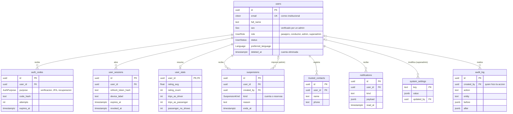
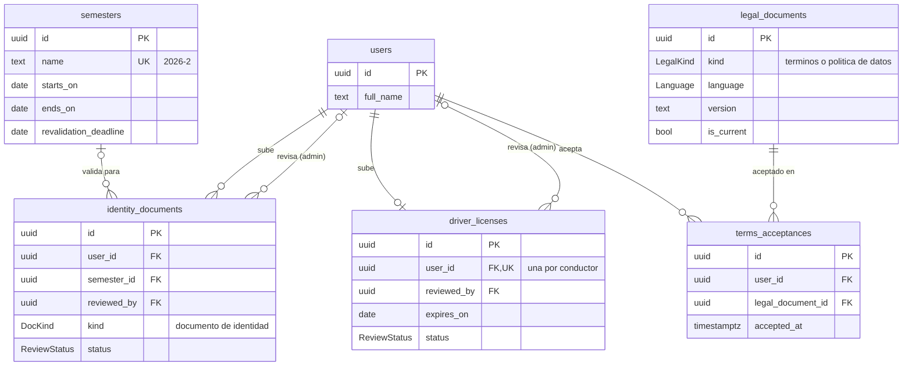
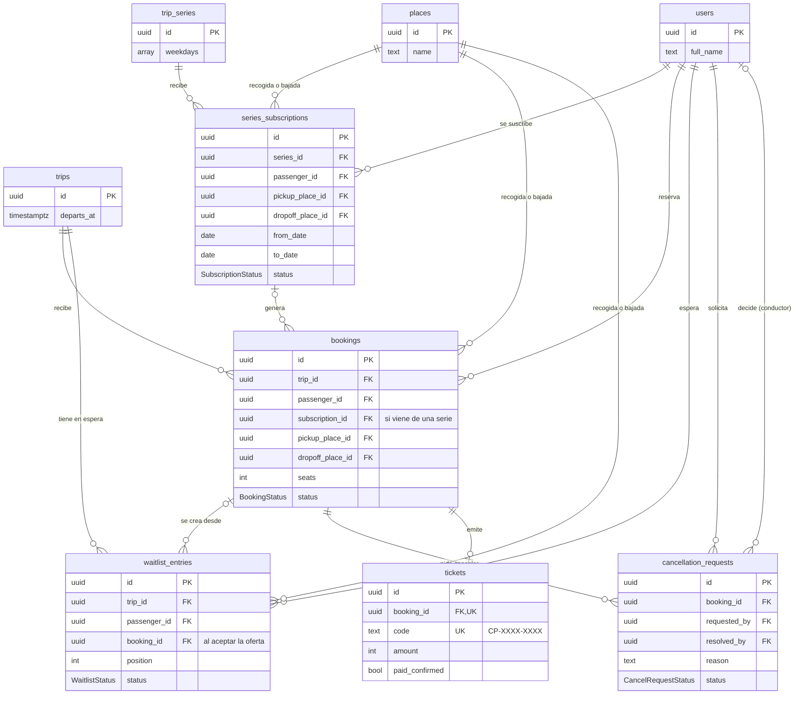
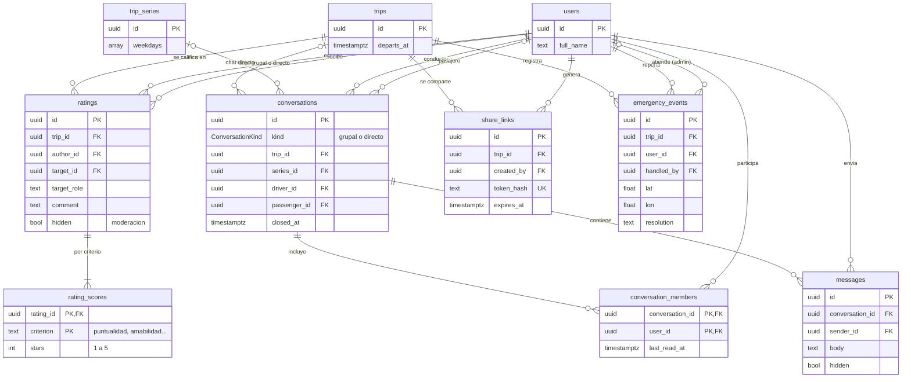

# Diagrama entidad-relación

Modelo de datos de Carpool UP: 35 tablas en PostgreSQL 16 con PostGIS, definidas con SQLAlchemy y versionadas con Alembic.

## Cómo leerlo

| Símbolo | Significado |
|---------|-------------|
| `PK` | Llave primaria |
| `FK` | Llave foránea |
| `UK` | Valor único |
| `\|\|--o{` | Uno a muchos (cero o más) |
| `\|\|--o\|` | Uno a cero o uno |
| `\|o--o{` | Opcional: la llave foránea puede ser nula |
| `\|\|--\|{` | Uno a uno o más |

- Las llaves primarias son UUID, salvo `system_settings` (clave de texto) y las tablas puente con llave compuesta (`conversation_members`, `rating_scores`).
- `geometry` son columnas de PostGIS: la ruta del viaje (`trips.route`) y la ubicación de cada lugar (`places.point`).
- Los tipos con mayúscula (`TripStatus`, `BookingStatus`...) son enums de PostgreSQL.
- Las relaciones marcadas como admin, conductor o superadmin son la persona que tomó la decisión: quién revisó un documento, quién atendió una emergencia, quién decidió una cancelación.
- **Autoría:** todas las tablas tienen `created_by` (quién creó la fila) y `updated_by` (quién la cambió por última vez), llaves foráneas a `users` que se llenan solas con el usuario de la petición (migración `0013`). Quedan nulas cuando el cambio lo hace el sistema (tareas programadas, seed) o alguien sin sesión (registro); en `suspensions`, `created_by` nulo sigue indicando una sanción automática. En `audit_log` el autor es `created_by` y `updated_by` queda siempre nulo. Para no llenar los diagramas de flechas hacia `users`, estas llaves aparecen en el anexo pero no se dibujan como relaciones, salvo las que ya tenían un significado propio (`places`, `share_links`, `suspensions`, `system_settings`, `audit_log`).
- Cada tabla muestra sus columnas clave. Todas las columnas están en el anexo del final.

## Diagrama general

Las 35 tablas agrupadas por módulo y todas sus relaciones. `users` es el centro: casi todo pertenece a una persona o lo decide una persona.

```mermaid
erDiagram
  %% ===== 1. Usuarios y acceso =====
  users {
    uuid id PK
    citext email UK "correo institucional"
    text full_name
    Sex sex "verificado por un admin"
    UserRole role "pasajero, conductor, admin, superadmin"
    UserStatus status
    Language preferred_language
    timestamptz deleted_at "cuenta eliminada"
  }
  auth_codes {
    uuid id PK
    uuid user_id FK
    AuthPurpose purpose "verificacion, 2FA, recuperacion"
    text code_hash
    int attempts
    timestamptz expires_at
  }
  user_sessions {
    uuid id PK
    uuid user_id FK
    text refresh_token_hash
    text device_label
    timestamptz expires_at
    timestamptz revoked_at
  }
  user_stats {
    uuid user_id PK, FK
    float rating_avg
    int rating_count
    int trips_as_driver
    int trips_as_passenger
    int passenger_no_shows
  }
  suspensions {
    uuid id PK
    uuid user_id FK
    uuid created_by FK
    SuspensionKind kind "cuenta o reservas"
    text reason
    timestamptz ends_at
  }
  trusted_contacts {
    uuid id PK
    uuid user_id FK
    text name
    text phone
  }
  notifications {
    uuid id PK
    uuid user_id FK
    text kind
    jsonb payload
    timestamptz read_at
  }

  %% ===== 2. Documentos y legal =====
  semesters {
    uuid id PK
    text name UK "2026-2"
    date starts_on
    date ends_on
    date revalidation_deadline
  }
  identity_documents {
    uuid id PK
    uuid user_id FK
    uuid semester_id FK
    uuid reviewed_by FK
    DocKind kind "documento de identidad"
    ReviewStatus status
  }
  driver_licenses {
    uuid id PK
    uuid user_id FK, UK "una por conductor"
    uuid reviewed_by FK
    date expires_on
    ReviewStatus status
  }
  legal_documents {
    uuid id PK
    LegalKind kind "terminos o politica de datos"
    Language language
    text version
    bool is_current
  }
  terms_acceptances {
    uuid id PK
    uuid user_id FK
    uuid legal_document_id FK
    timestamptz accepted_at
  }

  %% ===== 3. Vehiculos, lugares y viajes =====
  vehicles {
    uuid id PK
    uuid owner_id FK
    VehicleType type "carro o moto"
    text plate UK "entre vehiculos vigentes"
    text brand
    int capacity
    bool is_active
  }
  places {
    uuid id PK
    uuid created_by FK
    text name
    PlaceKind kind "sede, barrio, referencia"
    geometry point "PostGIS"
  }
  trip_series {
    uuid id PK
    uuid driver_id FK
    uuid vehicle_id FK
    uuid semester_id FK
    array weekdays
    time departure_time
    date window_end
    SeriesStatus status
  }
  series_stops {
    uuid id PK
    uuid series_id FK
    uuid place_id FK
    int position
  }
  trips {
    uuid id PK
    uuid driver_id FK
    uuid vehicle_id FK
    uuid series_id FK "si sale de una serie"
    timestamptz departs_at
    int seats_total
    int price_per_seat "aporte en COP"
    geometry route "PostGIS"
    TripStatus status
  }
  trip_stops {
    uuid id PK
    uuid trip_id FK
    uuid place_id FK
    int position
    timestamptz eta
  }
  trip_rules {
    uuid id PK
    uuid trip_id FK
    RuleKind kind "mascotas, fumar, solo mujeres..."
    text value
  }
  pico_placa_rules {
    uuid id PK
    VehicleType vehicle_type
    int weekday
    array restricted_digits
    date valid_from
  }
  traffic_factors {
    uuid id PK
    text weekday_group
    int hour
    float factor
  }

  %% ===== 4. Reservas =====
  series_subscriptions {
    uuid id PK
    uuid series_id FK
    uuid passenger_id FK
    uuid pickup_place_id FK
    uuid dropoff_place_id FK
    date from_date
    date to_date
    SubscriptionStatus status
  }
  bookings {
    uuid id PK
    uuid trip_id FK
    uuid passenger_id FK
    uuid subscription_id FK "si viene de una serie"
    uuid pickup_place_id FK
    uuid dropoff_place_id FK
    int seats
    BookingStatus status
  }
  waitlist_entries {
    uuid id PK
    uuid trip_id FK
    uuid passenger_id FK
    uuid booking_id FK "al aceptar la oferta"
    int position
    WaitlistStatus status
  }
  cancellation_requests {
    uuid id PK
    uuid booking_id FK
    uuid requested_by FK
    uuid resolved_by FK
    text reason
    CancelRequestStatus status
  }
  tickets {
    uuid id PK
    uuid booking_id FK, UK
    text code UK "CP-XXXX-XXXX"
    int amount
    bool paid_confirmed
  }

  %% ===== 5. Calificaciones =====
  ratings {
    uuid id PK
    uuid trip_id FK
    uuid author_id FK
    uuid target_id FK
    text target_role
    text comment
    bool hidden "moderacion"
  }
  rating_scores {
    uuid rating_id PK, FK
    text criterion PK "puntualidad, amabilidad..."
    int stars "1 a 5"
  }

  %% ===== 6. Chat y seguridad =====
  conversations {
    uuid id PK
    ConversationKind kind "grupal o directo"
    uuid trip_id FK
    uuid series_id FK
    uuid driver_id FK
    uuid passenger_id FK
    timestamptz closed_at
  }
  conversation_members {
    uuid conversation_id PK, FK
    uuid user_id PK, FK
    timestamptz last_read_at
  }
  messages {
    uuid id PK
    uuid conversation_id FK
    uuid sender_id FK
    text body
    bool hidden
  }
  share_links {
    uuid id PK
    uuid trip_id FK
    uuid created_by FK
    text token_hash UK
    timestamptz expires_at
  }
  emergency_events {
    uuid id PK
    uuid trip_id FK
    uuid user_id FK
    uuid handled_by FK
    float lat
    float lon
    text resolution
  }

  %% ===== 7. Administracion =====
  system_settings {
    text key PK
    jsonb value
    uuid updated_by FK
  }
  audit_log {
    uuid id PK
    uuid created_by FK "quien hizo la accion"
    text action
    text entity
    jsonb before
    jsonb after
  }

  %% ===== Relaciones: usuarios y acceso =====
  users ||--o{ auth_codes : "recibe"
  users ||--o{ user_sessions : "abre"
  users ||--o| user_stats : "resume"
  users ||--o{ suspensions : "recibe"
  users |o--o{ suspensions : "impone (admin)"
  users ||--o{ trusted_contacts : "registra"
  users ||--o{ notifications : "recibe"

  %% ===== Relaciones: documentos y legal =====
  users ||--o{ identity_documents : "sube"
  users |o--o{ identity_documents : "revisa (admin)"
  semesters |o--o{ identity_documents : "valida para"
  users ||--o| driver_licenses : "sube"
  users |o--o{ driver_licenses : "revisa (admin)"
  users ||--o{ terms_acceptances : "acepta"
  legal_documents ||--o{ terms_acceptances : "aceptado en"

  %% ===== Relaciones: vehiculos, lugares y viajes =====
  users ||--o{ vehicles : "posee"
  users |o--o{ places : "crea (admin)"
  users ||--o{ trip_series : "publica"
  vehicles ||--o{ trip_series : "usado en"
  semesters ||--o{ trip_series : "enmarca"
  trip_series ||--o{ series_stops : "tiene"
  places ||--o{ series_stops : "ubica"
  users ||--o{ trips : "conduce"
  vehicles ||--o{ trips : "usado en"
  trip_series |o--o{ trips : "genera"
  trips ||--o{ trip_stops : "tiene"
  places ||--o{ trip_stops : "ubica"
  trips ||--o{ trip_rules : "define"

  %% ===== Relaciones: reservas =====
  trip_series ||--o{ series_subscriptions : "recibe"
  users ||--o{ series_subscriptions : "se suscribe"
  places ||--o{ series_subscriptions : "recogida o bajada"
  trips ||--o{ bookings : "recibe"
  users ||--o{ bookings : "reserva"
  series_subscriptions |o--o{ bookings : "genera"
  places ||--o{ bookings : "recogida o bajada"
  trips ||--o{ waitlist_entries : "tiene en espera"
  users ||--o{ waitlist_entries : "espera"
  places ||--o{ waitlist_entries : "recogida o bajada"
  bookings |o--o{ waitlist_entries : "se crea desde"
  bookings ||--o{ cancellation_requests : "pide cancelar"
  users ||--o{ cancellation_requests : "solicita"
  users |o--o{ cancellation_requests : "decide (conductor)"
  bookings ||--o| tickets : "emite"

  %% ===== Relaciones: calificaciones =====
  trips ||--o{ ratings : "se califica en"
  users ||--o{ ratings : "escribe"
  users ||--o{ ratings : "recibe"
  ratings ||--|{ rating_scores : "por criterio"

  %% ===== Relaciones: chat y seguridad =====
  trips |o--o{ conversations : "chat grupal o directo"
  trip_series |o--o{ conversations : "chat directo"
  users ||--o{ conversations : "conductor"
  users |o--o{ conversations : "pasajero"
  conversations ||--o{ conversation_members : "incluye"
  users ||--o{ conversation_members : "participa"
  conversations ||--o{ messages : "contiene"
  users ||--o{ messages : "envia"
  trips ||--o{ share_links : "se comparte"
  users ||--o{ share_links : "genera"
  trips ||--o{ emergency_events : "registra"
  users ||--o{ emergency_events : "reporta"
  users |o--o{ emergency_events : "atiende (admin)"

  %% ===== Relaciones: administracion =====
  users |o--o{ system_settings : "modifica (superadmin)"
  users |o--o{ audit_log : "realiza"
```

## Vistas por módulo

Para explicar por partes. En cada vista, las tablas de otros módulos aparecen solo con su llave y el dato que las identifica.

### 1. Usuarios, acceso y administración

Cuenta, sesiones con token de refresco, códigos por correo, estadísticas, sanciones, contactos de confianza, avisos, parámetros del sistema y auditoría.

### 2. Documentos y legal

Documento de identidad por semestre, licencia de conducción, versiones de términos y política de datos, y su aceptación.

### 3. Vehículos, lugares y viajes

Vehículos del conductor, lugares del buscador, viajes puntuales y series semanales con sus paradas y reglas. Pico y placa y factores de tráfico son catálogos sin llaves foráneas.

```mermaid
erDiagram
  users {
    uuid id PK
    text full_name
  }
  semesters {
    uuid id PK
    text name
  }
  vehicles {
    uuid id PK
    uuid owner_id FK
    VehicleType type "carro o moto"
    text plate UK "entre vehiculos vigentes"
    text brand
    int capacity
    bool is_active
  }
  places {
    uuid id PK
    uuid created_by FK
    text name
    PlaceKind kind "sede, barrio, referencia"
    geometry point "PostGIS"
  }
  trip_series {
    uuid id PK
    uuid driver_id FK
    uuid vehicle_id FK
    uuid semester_id FK
    array weekdays
    time departure_time
    date window_end
    SeriesStatus status
  }
  series_stops {
    uuid id PK
    uuid series_id FK
    uuid place_id FK
    int position
  }
  trips {
    uuid id PK
    uuid driver_id FK
    uuid vehicle_id FK
    uuid series_id FK "si sale de una serie"
    timestamptz departs_at
    int seats_total
    int price_per_seat "aporte en COP"
    geometry route "PostGIS"
    TripStatus status
  }
  trip_stops {
    uuid id PK
    uuid trip_id FK
    uuid place_id FK
    int position
    timestamptz eta
  }
  trip_rules {
    uuid id PK
    uuid trip_id FK
    RuleKind kind "mascotas, fumar, solo mujeres..."
    text value
  }
  pico_placa_rules {
    uuid id PK
    VehicleType vehicle_type
    int weekday
    array restricted_digits
    date valid_from
  }
  traffic_factors {
    uuid id PK
    text weekday_group
    int hour
    float factor
  }
  users ||--o{ vehicles : "posee"
  users |o--o{ places : "crea (admin)"
  users ||--o{ trip_series : "publica"
  vehicles ||--o{ trip_series : "usado en"
  semesters ||--o{ trip_series : "enmarca"
  trip_series ||--o{ series_stops : "tiene"
  places ||--o{ series_stops : "ubica"
  users ||--o{ trips : "conduce"
  vehicles ||--o{ trips : "usado en"
  trip_series |o--o{ trips : "genera"
  trips ||--o{ trip_stops : "tiene"
  places ||--o{ trip_stops : "ubica"
  trips ||--o{ trip_rules : "define"
```

### 4. Reservas

Reservas de cupo, suscripciones a series, lista de espera, cancelaciones tardías y tickets.

### 5. Calificaciones, chat y seguridad

Calificaciones por criterio, chats del viaje, enlaces para compartir el viaje y emergencias.

## Anexo: todas las columnas

Generado a partir de los modelos de SQLAlchemy.

```mermaid
erDiagram
  audit_log {
    uuid created_by FK
    uuid updated_by FK
    text action
    text entity
    text entity_id
    jsonb before
    jsonb after
    text ip
    timestamptz created_at
    uuid id PK
  }
  auth_codes {
    uuid user_id FK
    AuthPurpose purpose
    text code_hash
    timestamptz expires_at
    int attempts
    timestamptz used_at
    uuid id PK
    timestamptz created_at
    timestamptz updated_at
    uuid created_by FK
    uuid updated_by FK
  }
  bookings {
    uuid trip_id FK
    uuid passenger_id FK
    uuid subscription_id FK
    int seats
    uuid pickup_place_id FK
    uuid dropoff_place_id FK
    text pickup_name
    float pickup_lat
    float pickup_lon
    timestamptz pickup_eta
    int pickup_walk_m
    text dropoff_name
    float dropoff_lat
    float dropoff_lon
    timestamptz dropoff_eta
    int dropoff_walk_m
    jsonb preferences
    BookingStatus status
    timestamptz expires_at
    bool penalty_free
    timestamptz decided_at
    timestamptz boarded_at
    timestamptz no_show_at
    timestamptz cancelled_at
    text cancel_reason
    uuid id PK
    timestamptz created_at
    timestamptz updated_at
    uuid created_by FK
    uuid updated_by FK
  }
  cancellation_requests {
    uuid booking_id FK
    uuid requested_by FK
    text reason
    CancelRequestStatus status
    uuid resolved_by FK
    timestamptz resolved_at
    uuid id PK
    timestamptz created_at
    timestamptz updated_at
    uuid created_by FK
    uuid updated_by FK
  }
  conversation_members {
    uuid conversation_id PK,FK
    uuid user_id PK,FK
    timestamptz joined_at
    timestamptz last_read_at
    timestamptz left_at
    uuid created_by FK
    uuid updated_by FK
  }
  conversations {
    ConversationKind kind
    uuid trip_id FK
    uuid series_id FK
    uuid driver_id FK
    uuid passenger_id FK
    timestamptz closed_at
    uuid id PK
    timestamptz created_at
    timestamptz updated_at
    uuid created_by FK
    uuid updated_by FK
  }
  driver_licenses {
    uuid user_id FK
    text file_path
    text content_type
    date expires_on
    ReviewStatus status
    uuid reviewed_by FK
    timestamptz reviewed_at
    text rejection_reason
    uuid id PK
    timestamptz created_at
    timestamptz updated_at
    uuid created_by FK
    uuid updated_by FK
  }
  emergency_events {
    uuid trip_id FK
    uuid user_id FK
    float lat
    float lon
    text note
    timestamptz created_at
    uuid handled_by FK
    timestamptz handled_at
    text resolution
    uuid id PK
    uuid created_by FK
    uuid updated_by FK
  }
  identity_documents {
    uuid user_id FK
    DocKind kind
    text file_path
    text content_type
    ReviewStatus status
    uuid semester_id FK
    uuid reviewed_by FK
    timestamptz reviewed_at
    text rejection_reason
    date valid_until
    uuid id PK
    timestamptz created_at
    timestamptz updated_at
    uuid created_by FK
    uuid updated_by FK
  }
  legal_documents {
    LegalKind kind
    text version
    Language language
    text body_markdown
    timestamptz published_at
    bool is_current
    uuid id PK
    timestamptz created_at
    timestamptz updated_at
    uuid created_by FK
    uuid updated_by FK
  }
  messages {
    uuid conversation_id FK
    uuid sender_id FK
    text body
    timestamptz sent_at
    bool hidden
    uuid id PK
    uuid created_by FK
    uuid updated_by FK
  }
  notifications {
    uuid user_id FK
    text kind
    jsonb payload
    timestamptz read_at
    timestamptz created_at
    uuid id PK
    uuid created_by FK
    uuid updated_by FK
  }
  pico_placa_rules {
    VehicleType vehicle_type
    int weekday
    array restricted_digits
    date valid_from
    date valid_to
    bool is_active
    uuid id PK
    timestamptz created_at
    timestamptz updated_at
    uuid created_by FK
    uuid updated_by FK
  }
  places {
    text name
    PlaceKind kind
    geometry_point point
    bool is_active
    uuid created_by FK
    uuid id PK
    timestamptz created_at
    timestamptz updated_at
    uuid updated_by FK
  }
  rating_scores {
    uuid rating_id PK,FK
    text criterion PK
    int stars
    uuid created_by FK
    uuid updated_by FK
  }
  ratings {
    uuid trip_id FK
    uuid author_id FK
    uuid target_id FK
    text target_role
    text comment
    bool hidden
    timestamptz created_at
    uuid id PK
    uuid created_by FK
    uuid updated_by FK
  }
  semesters {
    text name
    date starts_on
    date ends_on
    date revalidation_deadline
    uuid id PK
    timestamptz created_at
    timestamptz updated_at
    uuid created_by FK
    uuid updated_by FK
  }
  series_stops {
    uuid series_id FK
    uuid place_id FK
    int position
    StopKind kind
    uuid id PK
    timestamptz created_at
    timestamptz updated_at
    uuid created_by FK
    uuid updated_by FK
  }
  series_subscriptions {
    uuid series_id FK
    uuid passenger_id FK
    date from_date
    date to_date
    int seats
    uuid pickup_place_id FK
    uuid dropoff_place_id FK
    jsonb preferences
    SubscriptionStatus status
    timestamptz expires_at
    timestamptz decided_at
    timestamptz cancelled_at
    text reject_reason
    uuid id PK
    timestamptz created_at
    timestamptz updated_at
    uuid created_by FK
    uuid updated_by FK
  }
  share_links {
    uuid trip_id FK
    uuid created_by FK
    text token_hash
    timestamptz expires_at
    timestamptz created_at
    uuid id PK
    uuid updated_by FK
  }
  suspensions {
    uuid user_id FK
    SuspensionKind kind
    text reason
    timestamptz starts_at
    timestamptz ends_at
    uuid created_by FK
    uuid id PK
    timestamptz created_at
    timestamptz updated_at
    uuid updated_by FK
  }
  system_settings {
    text key PK
    jsonb value
    uuid updated_by FK
    timestamptz created_at
    timestamptz updated_at
    uuid created_by FK
  }
  terms_acceptances {
    uuid user_id FK
    uuid legal_document_id FK
    timestamptz accepted_at
    text ip
    uuid id PK
    uuid created_by FK
    uuid updated_by FK
  }
  tickets {
    uuid booking_id FK
    text code
    int amount
    timestamptz issued_at
    bool paid_confirmed
    timestamptz paid_confirmed_at
    uuid id PK
    uuid created_by FK
    uuid updated_by FK
  }
  traffic_factors {
    text weekday_group
    int hour
    float factor
    int samples
    uuid id PK
    timestamptz created_at
    timestamptz updated_at
    uuid created_by FK
    uuid updated_by FK
  }
  trip_rules {
    uuid trip_id FK
    RuleKind kind
    text value
    uuid id PK
    timestamptz created_at
    timestamptz updated_at
    uuid created_by FK
    uuid updated_by FK
  }
  trip_series {
    uuid driver_id FK
    uuid vehicle_id FK
    uuid semester_id FK
    array weekdays
    time departure_time
    date window_start
    date window_end
    int seats
    int price_per_seat
    SeriesStatus status
    jsonb rules
    text cancel_reason
    timestamptz cancelled_at
    uuid id PK
    timestamptz created_at
    timestamptz updated_at
    uuid created_by FK
    uuid updated_by FK
  }
  trip_stops {
    uuid trip_id FK
    uuid place_id FK
    int position
    StopKind kind
    timestamptz eta
    uuid id PK
    timestamptz created_at
    timestamptz updated_at
    uuid created_by FK
    uuid updated_by FK
  }
  trips {
    uuid driver_id FK
    uuid vehicle_id FK
    uuid series_id FK
    timestamptz departs_at
    int seats_total
    int price_per_seat
    geometry_linestring route
    int distance_m
    int est_duration_s
    int osrm_duration_s
    TripStatus status
    timestamptz started_at
    timestamptz finished_at
    text cancel_reason
    timestamptz cancelled_at
    timestamptz reminded_at
    timestamptz rating_reminded_at
    timestamptz deleted_at
    uuid id PK
    timestamptz created_at
    timestamptz updated_at
    uuid created_by FK
    uuid updated_by FK
  }
  trusted_contacts {
    uuid user_id FK
    text name
    text phone
    text relationship
    uuid id PK
    timestamptz created_at
    timestamptz updated_at
    uuid created_by FK
    uuid updated_by FK
  }
  user_sessions {
    uuid user_id FK
    text refresh_token_hash
    text device_label
    text ip
    text user_agent
    timestamptz expires_at
    timestamptz revoked_at
    timestamptz last_seen_at
    uuid id PK
    timestamptz created_at
    timestamptz updated_at
    uuid created_by FK
    uuid updated_by FK
  }
  user_stats {
    uuid user_id PK,FK
    float rating_avg
    int rating_count
    int trips_as_driver
    int trips_as_passenger
    int driver_cancellations
    int passenger_no_shows
    jsonb criteria
    timestamptz updated_at
    uuid created_by FK
    uuid updated_by FK
  }
  users {
    text email
    text password_hash
    text full_name
    Sex sex
    text program
    UserRole role
    UserStatus status
    text avatar_path
    text payment_note
    bool two_factor_required
    Language preferred_language
    ThemePreference theme_preference
    int failed_login_attempts
    timestamptz locked_until
    timestamptz last_login_at
    timestamptz deleted_at
    uuid id PK
    timestamptz created_at
    timestamptz updated_at
    uuid created_by FK
    uuid updated_by FK
  }
  vehicles {
    uuid owner_id FK
    VehicleType type
    text plate
    text brand
    text model
    text color
    int year
    int capacity
    bool luggage_space
    text photo_path
    text photo_content_type
    bool is_active
    timestamptz deleted_at
    uuid id PK
    timestamptz created_at
    timestamptz updated_at
    uuid created_by FK
    uuid updated_by FK
  }
  waitlist_entries {
    uuid trip_id FK
    uuid passenger_id FK
    int seats
    uuid pickup_place_id FK
    uuid dropoff_place_id FK
    jsonb preferences
    int position
    WaitlistStatus status
    timestamptz offered_at
    timestamptz offer_expires_at
    uuid booking_id FK
    uuid id PK
    timestamptz created_at
    timestamptz updated_at
    uuid created_by FK
    uuid updated_by FK
  }
  users |o--o{ audit_log : "created_by"
  users ||--o{ auth_codes : "user_id"
  trips ||--o{ bookings : "trip_id"
  users ||--o{ bookings : "passenger_id"
  series_subscriptions |o--o{ bookings : "subscription_id"
  places ||--o{ bookings : "pickup_place_id"
  places ||--o{ bookings : "dropoff_place_id"
  bookings ||--o{ cancellation_requests : "booking_id"
  users ||--o{ cancellation_requests : "requested_by"
  users |o--o{ cancellation_requests : "resolved_by"
  conversations ||--o{ conversation_members : "conversation_id"
  users ||--o{ conversation_members : "user_id"
  trips |o--o{ conversations : "trip_id"
  trip_series |o--o{ conversations : "series_id"
  users ||--o{ conversations : "driver_id"
  users |o--o{ conversations : "passenger_id"
  users ||--o| driver_licenses : "user_id"
  users |o--o{ driver_licenses : "reviewed_by"
  trips ||--o{ emergency_events : "trip_id"
  users ||--o{ emergency_events : "user_id"
  users |o--o{ emergency_events : "handled_by"
  users ||--o{ identity_documents : "user_id"
  semesters |o--o{ identity_documents : "semester_id"
  users |o--o{ identity_documents : "reviewed_by"
  conversations ||--o{ messages : "conversation_id"
  users ||--o{ messages : "sender_id"
  users ||--o{ notifications : "user_id"
  users |o--o{ places : "created_by"
  ratings ||--o{ rating_scores : "rating_id"
  trips ||--o{ ratings : "trip_id"
  users ||--o{ ratings : "author_id"
  users ||--o{ ratings : "target_id"
  trip_series ||--o{ series_stops : "series_id"
  places ||--o{ series_stops : "place_id"
  trip_series ||--o{ series_subscriptions : "series_id"
  users ||--o{ series_subscriptions : "passenger_id"
  places ||--o{ series_subscriptions : "pickup_place_id"
  places ||--o{ series_subscriptions : "dropoff_place_id"
  trips ||--o{ share_links : "trip_id"
  users ||--o{ share_links : "created_by"
  users ||--o{ suspensions : "user_id"
  users |o--o{ suspensions : "created_by"
  users |o--o{ system_settings : "updated_by"
  users ||--o{ terms_acceptances : "user_id"
  legal_documents ||--o{ terms_acceptances : "legal_document_id"
  bookings ||--o| tickets : "booking_id"
  trips ||--o{ trip_rules : "trip_id"
  users ||--o{ trip_series : "driver_id"
  vehicles ||--o{ trip_series : "vehicle_id"
  semesters ||--o{ trip_series : "semester_id"
  trips ||--o{ trip_stops : "trip_id"
  places ||--o{ trip_stops : "place_id"
  users ||--o{ trips : "driver_id"
  vehicles ||--o{ trips : "vehicle_id"
  trip_series |o--o{ trips : "series_id"
  users ||--o{ trusted_contacts : "user_id"
  users ||--o{ user_sessions : "user_id"
  users ||--o| user_stats : "user_id"
  users ||--o{ vehicles : "owner_id"
  trips ||--o{ waitlist_entries : "trip_id"
  users ||--o{ waitlist_entries : "passenger_id"
  places ||--o{ waitlist_entries : "pickup_place_id"
  places ||--o{ waitlist_entries : "dropoff_place_id"
  bookings |o--o{ waitlist_entries : "booking_id"
```

