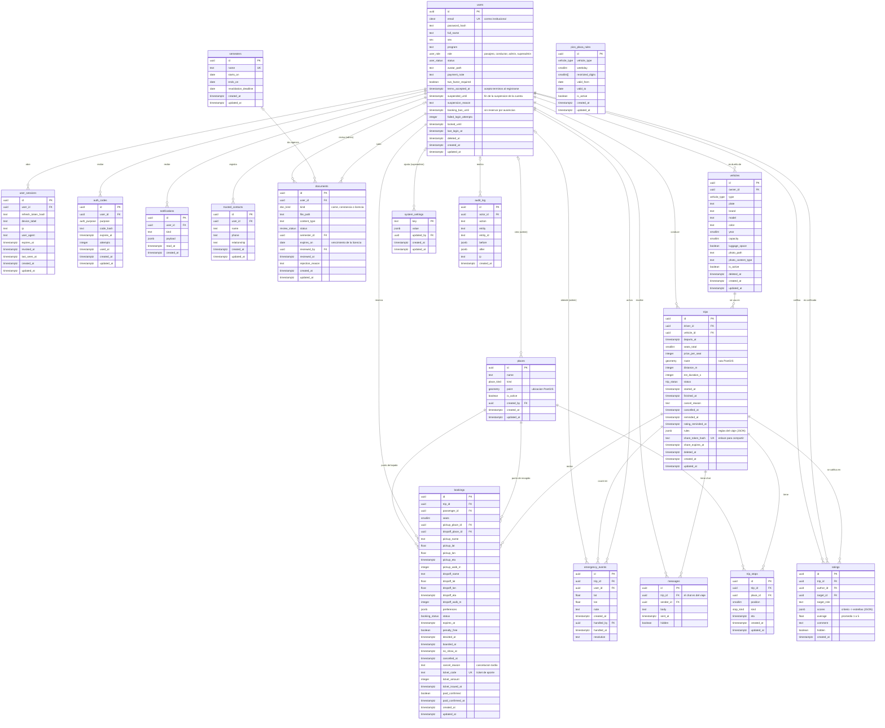
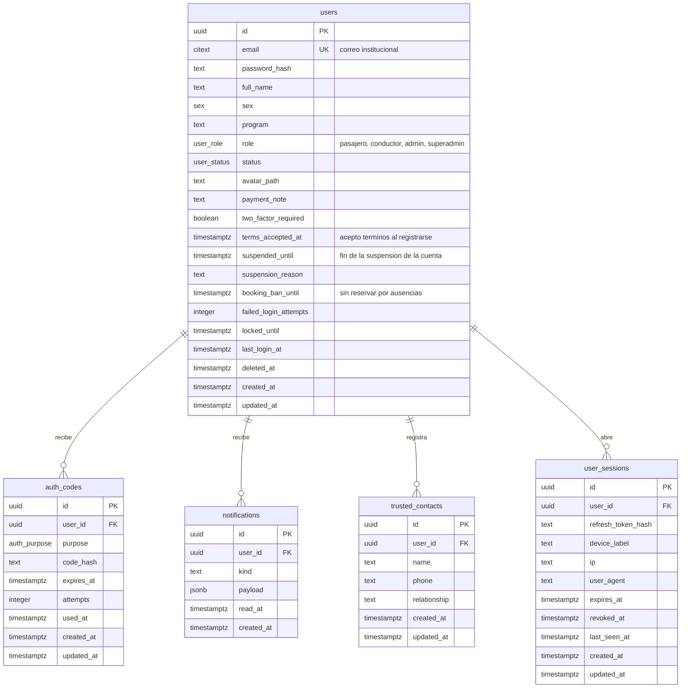
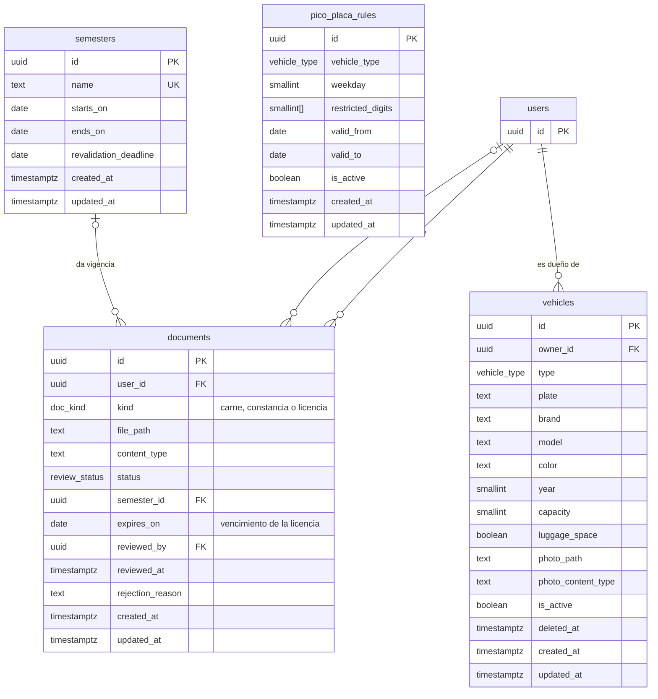
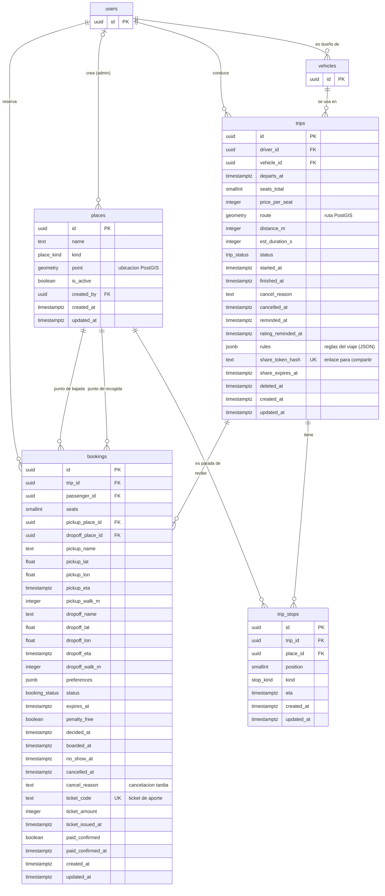
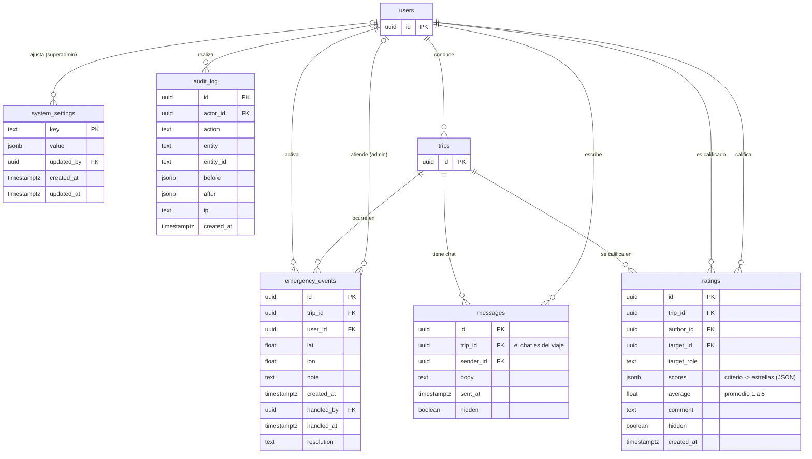

# Diagrama entidad-relación

Modelo de datos de Carpool UP: **18 tablas** en PostgreSQL 16 con PostGIS, definidas con SQLAlchemy y creadas por una única migración de Alembic (`backend/alembic/versions/20261014_0001_esquema_inicial.py`).

## Cómo leerlo

| Símbolo | Significado |
|---------|-------------|
| `PK` | Llave primaria |
| `FK` | Llave foránea |
| `UK` | Valor único |
| `\|\|--o{` | Uno a muchos (cero o más) |
| `\|\|--o\|` | Uno a cero o uno |
| `\|o--o{` | Opcional: la llave foránea puede ser nula |

- Las llaves primarias son UUID, salvo `system_settings` (clave de texto) y `audit_log` (entero autoincremental).
- `geometry` son columnas de PostGIS: la ruta del viaje (`trips.route`) y la ubicación de cada lugar (`places.point`).
- `jsonb` guarda datos que antes eran tablas aparte: las reglas del viaje (`trips.rules`) y los criterios de cada calificación (`ratings.scores`).
- Los tipos `enum` son enums de PostgreSQL (estado del viaje, de la reserva, rol, etc.).

## Diagrama general

`users` es el centro: casi todo pertenece a una persona o lo decide una persona. `trips` es el segundo eje: paradas, reservas, calificaciones, chat y emergencias cuelgan del viaje.

## 1. Usuarios y acceso

La cuenta, sus sesiones, los códigos de verificación enviados al correo, los avisos y los contactos de confianza. Las sanciones (suspensión de la cuenta y de reservas) son columnas de `users`.

## 2. Documentos y vehículos

Una sola tabla `documents` guarda el carné o constancia del semestre y la licencia de conducción (`kind`), con su revisión. Los vehículos del conductor y las reglas de pico y placa.

## 3. Viajes y reservas

El viaje con su ruta PostGIS, sus reglas (JSON) y su enlace para compartir; sus paradas en orden; y las reservas, que también guardan la cancelación tardía y el ticket de aporte.

## 4. Calificaciones, chat, seguridad y administración

Calificaciones con sus criterios en JSON, el chat de cada viaje, las alertas de emergencia, los parámetros del negocio y la auditoría inmutable.

## Relaciones

| Desde | Hacia | Llave foránea | Significado |
|-------|-------|---------------|-------------|
| `users` | `audit_log` | `audit_log.actor_id` | realiza |
| `users` | `auth_codes` | `auth_codes.user_id` | recibe |
| `places` | `bookings` | `bookings.dropoff_place_id` | punto de bajada |
| `users` | `bookings` | `bookings.passenger_id` | reserva |
| `places` | `bookings` | `bookings.pickup_place_id` | punto de recogida |
| `trips` | `bookings` | `bookings.trip_id` | recibe |
| `users` | `documents` | `documents.reviewed_by` | revisa (admin) |
| `semesters` | `documents` | `documents.semester_id` | da vigencia |
| `users` | `documents` | `documents.user_id` | sube |
| `users` | `emergency_events` | `emergency_events.handled_by` | atiende (admin) |
| `trips` | `emergency_events` | `emergency_events.trip_id` | ocurre en |
| `users` | `emergency_events` | `emergency_events.user_id` | activa |
| `users` | `messages` | `messages.sender_id` | escribe |
| `trips` | `messages` | `messages.trip_id` | tiene chat |
| `users` | `notifications` | `notifications.user_id` | recibe |
| `users` | `places` | `places.created_by` | crea (admin) |
| `users` | `ratings` | `ratings.author_id` | califica |
| `users` | `ratings` | `ratings.target_id` | es calificado |
| `trips` | `ratings` | `ratings.trip_id` | se califica en |
| `users` | `system_settings` | `system_settings.updated_by` | ajusta (superadmin) |
| `places` | `trip_stops` | `trip_stops.place_id` | es parada de |
| `trips` | `trip_stops` | `trip_stops.trip_id` | tiene |
| `users` | `trips` | `trips.driver_id` | conduce |
| `vehicles` | `trips` | `trips.vehicle_id` | se usa en |
| `users` | `trusted_contacts` | `trusted_contacts.user_id` | registra |
| `users` | `user_sessions` | `user_sessions.user_id` | abre |
| `users` | `vehicles` | `vehicles.owner_id` | es dueño de |

## Qué cambió frente al modelo anterior (35 tablas)

| Antes | Ahora |
|-------|-------|
| `identity_documents` y `driver_licenses` | `documents` con `kind` |
| `cancellation_requests` | columnas `cancel_reason` y estado `cancel_requested` en `bookings` |
| `tickets` | columnas `ticket_*` y `paid_confirmed*` en `bookings` |
| `trip_rules` | `trips.rules` (JSON) |
| `rating_scores` | `ratings.scores` (JSON) y `ratings.average` |
| `conversations` y `conversation_members` | `messages.trip_id`: un chat por viaje |
| `share_links` | `trips.share_token_hash` y `trips.share_expires_at` |
| `suspensions` | `users.suspended_until`, `users.suspension_reason`, `users.booking_ban_until` |
| `user_stats` | se calcula con consultas agrupadas al pedirla |
| `legal_documents` y `terms_acceptances` | archivos `frontend/public/legal/*.md` y `users.terms_accepted_at` |
| `trip_series`, `series_stops`, `series_subscriptions`, `waitlist_entries`, `traffic_factors` | eliminadas junto con su función (viajes recurrentes, lista de espera y factor de tráfico) |

## Anexo: todas las columnas

### `users`

| Columna | Tipo | Nula | Llave |
|---------|------|------|-------|
| `id` | uuid | no | PK |
| `email` | citext | no | UK |
| `password_hash` | text | no |  |
| `full_name` | text | no |  |
| `sex` | sex | no |  |
| `program` | text | sí |  |
| `role` | user_role | no |  |
| `status` | user_status | no |  |
| `avatar_path` | text | sí |  |
| `payment_note` | text | sí |  |
| `two_factor_required` | boolean | no |  |
| `terms_accepted_at` | timestamptz | sí |  |
| `suspended_until` | timestamptz | sí |  |
| `suspension_reason` | text | sí |  |
| `booking_ban_until` | timestamptz | sí |  |
| `failed_login_attempts` | integer | no |  |
| `locked_until` | timestamptz | sí |  |
| `last_login_at` | timestamptz | sí |  |
| `deleted_at` | timestamptz | sí |  |
| `created_at` | timestamptz | no |  |
| `updated_at` | timestamptz | no |  |

### `user_sessions`

| Columna | Tipo | Nula | Llave |
|---------|------|------|-------|
| `id` | uuid | no | PK |
| `user_id` | uuid | no | FK → `users` |
| `refresh_token_hash` | text | no |  |
| `device_label` | text | no |  |
| `ip` | text | sí |  |
| `user_agent` | text | sí |  |
| `expires_at` | timestamptz | no |  |
| `revoked_at` | timestamptz | sí |  |
| `last_seen_at` | timestamptz | no |  |
| `created_at` | timestamptz | no |  |
| `updated_at` | timestamptz | no |  |

### `auth_codes`

| Columna | Tipo | Nula | Llave |
|---------|------|------|-------|
| `id` | uuid | no | PK |
| `user_id` | uuid | no | FK → `users` |
| `purpose` | auth_purpose | no |  |
| `code_hash` | text | no |  |
| `expires_at` | timestamptz | no |  |
| `attempts` | integer | no |  |
| `used_at` | timestamptz | sí |  |
| `created_at` | timestamptz | no |  |
| `updated_at` | timestamptz | no |  |

### `notifications`

| Columna | Tipo | Nula | Llave |
|---------|------|------|-------|
| `id` | uuid | no | PK |
| `user_id` | uuid | no | FK → `users` |
| `kind` | text | no |  |
| `payload` | jsonb | no |  |
| `read_at` | timestamptz | sí |  |
| `created_at` | timestamptz | no |  |

### `trusted_contacts`

| Columna | Tipo | Nula | Llave |
|---------|------|------|-------|
| `id` | uuid | no | PK |
| `user_id` | uuid | no | FK → `users` |
| `name` | text | no |  |
| `phone` | text | no |  |
| `relationship` | text | sí |  |
| `created_at` | timestamptz | no |  |
| `updated_at` | timestamptz | no |  |

### `semesters`

| Columna | Tipo | Nula | Llave |
|---------|------|------|-------|
| `id` | uuid | no | PK |
| `name` | text | no | UK |
| `starts_on` | date | no |  |
| `ends_on` | date | no |  |
| `revalidation_deadline` | date | no |  |
| `created_at` | timestamptz | no |  |
| `updated_at` | timestamptz | no |  |

### `documents`

| Columna | Tipo | Nula | Llave |
|---------|------|------|-------|
| `id` | uuid | no | PK |
| `user_id` | uuid | no | FK → `users` |
| `kind` | doc_kind | no |  |
| `file_path` | text | no |  |
| `content_type` | text | no |  |
| `status` | review_status | no |  |
| `semester_id` | uuid | sí | FK → `semesters` |
| `expires_on` | date | sí |  |
| `reviewed_by` | uuid | sí | FK → `users` |
| `reviewed_at` | timestamptz | sí |  |
| `rejection_reason` | text | sí |  |
| `created_at` | timestamptz | no |  |
| `updated_at` | timestamptz | no |  |

### `vehicles`

| Columna | Tipo | Nula | Llave |
|---------|------|------|-------|
| `id` | uuid | no | PK |
| `owner_id` | uuid | no | FK → `users` |
| `type` | vehicle_type | no |  |
| `plate` | text | no |  |
| `brand` | text | no |  |
| `model` | text | no |  |
| `color` | text | no |  |
| `year` | smallint | no |  |
| `capacity` | smallint | no |  |
| `luggage_space` | boolean | no |  |
| `photo_path` | text | sí |  |
| `photo_content_type` | text | sí |  |
| `is_active` | boolean | no |  |
| `deleted_at` | timestamptz | sí |  |
| `created_at` | timestamptz | no |  |
| `updated_at` | timestamptz | no |  |

### `pico_placa_rules`

| Columna | Tipo | Nula | Llave |
|---------|------|------|-------|
| `id` | uuid | no | PK |
| `vehicle_type` | vehicle_type | no |  |
| `weekday` | smallint | no |  |
| `restricted_digits` | smallint[] | no |  |
| `valid_from` | date | no |  |
| `valid_to` | date | sí |  |
| `is_active` | boolean | no |  |
| `created_at` | timestamptz | no |  |
| `updated_at` | timestamptz | no |  |

### `places`

| Columna | Tipo | Nula | Llave |
|---------|------|------|-------|
| `id` | uuid | no | PK |
| `name` | text | no |  |
| `kind` | place_kind | no |  |
| `point` | geometry | no |  |
| `is_active` | boolean | no |  |
| `created_by` | uuid | sí | FK → `users` |
| `created_at` | timestamptz | no |  |
| `updated_at` | timestamptz | no |  |

### `trips`

| Columna | Tipo | Nula | Llave |
|---------|------|------|-------|
| `id` | uuid | no | PK |
| `driver_id` | uuid | no | FK → `users` |
| `vehicle_id` | uuid | no | FK → `vehicles` |
| `departs_at` | timestamptz | no |  |
| `seats_total` | smallint | no |  |
| `price_per_seat` | integer | no |  |
| `route` | geometry | no |  |
| `distance_m` | integer | no |  |
| `est_duration_s` | integer | no |  |
| `status` | trip_status | no |  |
| `started_at` | timestamptz | sí |  |
| `finished_at` | timestamptz | sí |  |
| `cancel_reason` | text | sí |  |
| `cancelled_at` | timestamptz | sí |  |
| `reminded_at` | timestamptz | sí |  |
| `rating_reminded_at` | timestamptz | sí |  |
| `rules` | jsonb | no |  |
| `share_token_hash` | text | sí | UK |
| `share_expires_at` | timestamptz | sí |  |
| `deleted_at` | timestamptz | sí |  |
| `created_at` | timestamptz | no |  |
| `updated_at` | timestamptz | no |  |

### `trip_stops`

| Columna | Tipo | Nula | Llave |
|---------|------|------|-------|
| `id` | uuid | no | PK |
| `trip_id` | uuid | no | FK → `trips` |
| `place_id` | uuid | no | FK → `places` |
| `position` | smallint | no |  |
| `kind` | stop_kind | no |  |
| `eta` | timestamptz | no |  |
| `created_at` | timestamptz | no |  |
| `updated_at` | timestamptz | no |  |

### `bookings`

| Columna | Tipo | Nula | Llave |
|---------|------|------|-------|
| `id` | uuid | no | PK |
| `trip_id` | uuid | no | FK → `trips` |
| `passenger_id` | uuid | no | FK → `users` |
| `seats` | smallint | no |  |
| `pickup_place_id` | uuid | no | FK → `places` |
| `dropoff_place_id` | uuid | no | FK → `places` |
| `pickup_name` | text | sí |  |
| `pickup_lat` | float | no |  |
| `pickup_lon` | float | no |  |
| `pickup_eta` | timestamptz | no |  |
| `pickup_walk_m` | integer | no |  |
| `dropoff_name` | text | sí |  |
| `dropoff_lat` | float | no |  |
| `dropoff_lon` | float | no |  |
| `dropoff_eta` | timestamptz | no |  |
| `dropoff_walk_m` | integer | no |  |
| `preferences` | jsonb | no |  |
| `status` | booking_status | no |  |
| `expires_at` | timestamptz | no |  |
| `penalty_free` | boolean | no |  |
| `decided_at` | timestamptz | sí |  |
| `boarded_at` | timestamptz | sí |  |
| `no_show_at` | timestamptz | sí |  |
| `cancelled_at` | timestamptz | sí |  |
| `cancel_reason` | text | sí |  |
| `ticket_code` | text | sí | UK |
| `ticket_amount` | integer | sí |  |
| `ticket_issued_at` | timestamptz | sí |  |
| `paid_confirmed` | boolean | no |  |
| `paid_confirmed_at` | timestamptz | sí |  |
| `created_at` | timestamptz | no |  |
| `updated_at` | timestamptz | no |  |

### `ratings`

| Columna | Tipo | Nula | Llave |
|---------|------|------|-------|
| `id` | uuid | no | PK |
| `trip_id` | uuid | no | FK → `trips` |
| `author_id` | uuid | no | FK → `users` |
| `target_id` | uuid | no | FK → `users` |
| `target_role` | text | no |  |
| `scores` | jsonb | no |  |
| `average` | float | no |  |
| `comment` | text | sí |  |
| `hidden` | boolean | no |  |
| `created_at` | timestamptz | no |  |

### `messages`

| Columna | Tipo | Nula | Llave |
|---------|------|------|-------|
| `id` | uuid | no | PK |
| `trip_id` | uuid | no | FK → `trips` |
| `sender_id` | uuid | no | FK → `users` |
| `body` | text | no |  |
| `sent_at` | timestamptz | no |  |
| `hidden` | boolean | no |  |

### `emergency_events`

| Columna | Tipo | Nula | Llave |
|---------|------|------|-------|
| `id` | uuid | no | PK |
| `trip_id` | uuid | no | FK → `trips` |
| `user_id` | uuid | no | FK → `users` |
| `lat` | float | sí |  |
| `lon` | float | sí |  |
| `note` | text | sí |  |
| `created_at` | timestamptz | no |  |
| `handled_by` | uuid | sí | FK → `users` |
| `handled_at` | timestamptz | sí |  |
| `resolution` | text | sí |  |

### `system_settings`

| Columna | Tipo | Nula | Llave |
|---------|------|------|-------|
| `key` | text | no | PK |
| `value` | jsonb | no |  |
| `updated_by` | uuid | sí | FK → `users` |
| `created_at` | timestamptz | no |  |
| `updated_at` | timestamptz | no |  |

### `audit_log`

| Columna | Tipo | Nula | Llave |
|---------|------|------|-------|
| `id` | uuid | no | PK |
| `actor_id` | uuid | sí | FK → `users` |
| `action` | text | no |  |
| `entity` | text | no |  |
| `entity_id` | text | sí |  |
| `before` | jsonb | sí |  |
| `after` | jsonb | sí |  |
| `ip` | text | sí |  |
| `created_at` | timestamptz | no |  |
