# Diagrama entidad-relación

Generado a partir de los modelos de SQLAlchemy (35 tablas). `PK` es llave primaria y `FK` llave foránea.
Notación de Mermaid: `||` exactamente uno, `|o` cero o uno, `o{` cero o muchos, `o|` cero o uno del lado hijo.
Las columnas `route` y `point` son geometrías de PostGIS (SRID 4326); los tipos con nombre propio son enums de PostgreSQL.

```mermaid
erDiagram
  audit_log {
    uuid actor_id FK
    text action
    text entity
    text entity_id
    jsonb before
    jsonb after
    text ip
    timestamptz created_at
    uuid id PK
  }
  auth_codes {
    uuid user_id FK
    AuthPurpose purpose
    text code_hash
    timestamptz expires_at
    int attempts
    timestamptz used_at
    uuid id PK
    timestamptz created_at
    timestamptz updated_at
  }
  bookings {
    uuid trip_id FK
    uuid passenger_id FK
    uuid subscription_id FK
    int seats
    uuid pickup_place_id FK
    uuid dropoff_place_id FK
    text pickup_name
    float pickup_lat
    float pickup_lon
    timestamptz pickup_eta
    int pickup_walk_m
    text dropoff_name
    float dropoff_lat
    float dropoff_lon
    timestamptz dropoff_eta
    int dropoff_walk_m
    jsonb preferences
    BookingStatus status
    timestamptz expires_at
    bool penalty_free
    timestamptz decided_at
    timestamptz boarded_at
    timestamptz no_show_at
    timestamptz cancelled_at
    text cancel_reason
    uuid id PK
    timestamptz created_at
    timestamptz updated_at
  }
  cancellation_requests {
    uuid booking_id FK
    uuid requested_by FK
    text reason
    CancelRequestStatus status
    uuid resolved_by FK
    timestamptz resolved_at
    uuid id PK
    timestamptz created_at
    timestamptz updated_at
  }
  conversation_members {
    uuid conversation_id PK,FK
    uuid user_id PK,FK
    timestamptz joined_at
    timestamptz last_read_at
    timestamptz left_at
  }
  conversations {
    ConversationKind kind
    uuid trip_id FK
    uuid series_id FK
    uuid driver_id FK
    uuid passenger_id FK
    timestamptz closed_at
    uuid id PK
    timestamptz created_at
    timestamptz updated_at
  }
  driver_licenses {
    uuid user_id FK
    text file_path
    text content_type
    date expires_on
    ReviewStatus status
    uuid reviewed_by FK
    timestamptz reviewed_at
    text rejection_reason
    uuid id PK
    timestamptz created_at
    timestamptz updated_at
  }
  emergency_events {
    uuid trip_id FK
    uuid user_id FK
    float lat
    float lon
    text note
    timestamptz created_at
    uuid handled_by FK
    timestamptz handled_at
    text resolution
    uuid id PK
  }
  identity_documents {
    uuid user_id FK
    DocKind kind
    text file_path
    text content_type
    ReviewStatus status
    uuid semester_id FK
    uuid reviewed_by FK
    timestamptz reviewed_at
    text rejection_reason
    date valid_until
    uuid id PK
    timestamptz created_at
    timestamptz updated_at
  }
  legal_documents {
    LegalKind kind
    text version
    Language language
    text body_markdown
    timestamptz published_at
    bool is_current
    uuid id PK
    timestamptz created_at
    timestamptz updated_at
  }
  messages {
    uuid conversation_id FK
    uuid sender_id FK
    text body
    timestamptz sent_at
    bool hidden
    uuid id PK
  }
  notifications {
    uuid user_id FK
    text kind
    jsonb payload
    timestamptz read_at
    timestamptz created_at
    uuid id PK
  }
  pico_placa_rules {
    VehicleType vehicle_type
    int weekday
    array restricted_digits
    date valid_from
    date valid_to
    bool is_active
    uuid id PK
    timestamptz created_at
    timestamptz updated_at
  }
  places {
    text name
    PlaceKind kind
    geometry_point point
    bool is_active
    uuid created_by FK
    uuid id PK
    timestamptz created_at
    timestamptz updated_at
  }
  rating_scores {
    uuid rating_id PK,FK
    text criterion PK
    int stars
  }
  ratings {
    uuid trip_id FK
    uuid author_id FK
    uuid target_id FK
    text target_role
    text comment
    bool hidden
    timestamptz created_at
    uuid id PK
  }
  semesters {
    text name
    date starts_on
    date ends_on
    date revalidation_deadline
    uuid id PK
    timestamptz created_at
    timestamptz updated_at
  }
  series_stops {
    uuid series_id FK
    uuid place_id FK
    int position
    StopKind kind
    uuid id PK
    timestamptz created_at
    timestamptz updated_at
  }
  series_subscriptions {
    uuid series_id FK
    uuid passenger_id FK
    date from_date
    date to_date
    int seats
    uuid pickup_place_id FK
    uuid dropoff_place_id FK
    jsonb preferences
    SubscriptionStatus status
    timestamptz expires_at
    timestamptz decided_at
    timestamptz cancelled_at
    text reject_reason
    uuid id PK
    timestamptz created_at
    timestamptz updated_at
  }
  share_links {
    uuid trip_id FK
    uuid created_by FK
    text token_hash
    timestamptz expires_at
    timestamptz created_at
    uuid id PK
  }
  suspensions {
    uuid user_id FK
    SuspensionKind kind
    text reason
    timestamptz starts_at
    timestamptz ends_at
    uuid created_by FK
    uuid id PK
    timestamptz created_at
    timestamptz updated_at
  }
  system_settings {
    text key PK
    jsonb value
    uuid updated_by FK
    timestamptz created_at
    timestamptz updated_at
  }
  terms_acceptances {
    uuid user_id FK
    uuid legal_document_id FK
    timestamptz accepted_at
    text ip
    uuid id PK
  }
  tickets {
    uuid booking_id FK
    text code
    int amount
    timestamptz issued_at
    bool paid_confirmed
    timestamptz paid_confirmed_at
    uuid id PK
  }
  traffic_factors {
    text weekday_group
    int hour
    float factor
    int samples
    uuid id PK
    timestamptz created_at
    timestamptz updated_at
  }
  trip_rules {
    uuid trip_id FK
    RuleKind kind
    text value
    uuid id PK
    timestamptz created_at
    timestamptz updated_at
  }
  trip_series {
    uuid driver_id FK
    uuid vehicle_id FK
    uuid semester_id FK
    array weekdays
    time departure_time
    date window_start
    date window_end
    int seats
    int price_per_seat
    SeriesStatus status
    jsonb rules
    text cancel_reason
    timestamptz cancelled_at
    uuid id PK
    timestamptz created_at
    timestamptz updated_at
  }
  trip_stops {
    uuid trip_id FK
    uuid place_id FK
    int position
    StopKind kind
    timestamptz eta
    uuid id PK
    timestamptz created_at
    timestamptz updated_at
  }
  trips {
    uuid driver_id FK
    uuid vehicle_id FK
    uuid series_id FK
    timestamptz departs_at
    int seats_total
    int price_per_seat
    geometry_linestring route
    int distance_m
    int est_duration_s
    int osrm_duration_s
    TripStatus status
    timestamptz started_at
    timestamptz finished_at
    text cancel_reason
    timestamptz cancelled_at
    timestamptz reminded_at
    timestamptz rating_reminded_at
    timestamptz deleted_at
    uuid id PK
    timestamptz created_at
    timestamptz updated_at
  }
  trusted_contacts {
    uuid user_id FK
    text name
    text phone
    text relationship
    uuid id PK
    timestamptz created_at
    timestamptz updated_at
  }
  user_sessions {
    uuid user_id FK
    text refresh_token_hash
    text device_label
    text ip
    text user_agent
    timestamptz expires_at
    timestamptz revoked_at
    timestamptz last_seen_at
    uuid id PK
    timestamptz created_at
    timestamptz updated_at
  }
  user_stats {
    uuid user_id PK,FK
    float rating_avg
    int rating_count
    int trips_as_driver
    int trips_as_passenger
    int driver_cancellations
    int passenger_no_shows
    jsonb criteria
    timestamptz updated_at
  }
  users {
    text email
    text password_hash
    text full_name
    Sex sex
    text program
    UserRole role
    UserStatus status
    text avatar_path
    text payment_note
    bool two_factor_required
    Language preferred_language
    ThemePreference theme_preference
    int failed_login_attempts
    timestamptz locked_until
    timestamptz last_login_at
    timestamptz deleted_at
    uuid id PK
    timestamptz created_at
    timestamptz updated_at
  }
  vehicles {
    uuid owner_id FK
    VehicleType type
    text plate
    text brand
    text model
    text color
    int year
    int capacity
    bool luggage_space
    text photo_path
    text photo_content_type
    bool is_active
    timestamptz deleted_at
    uuid id PK
    timestamptz created_at
    timestamptz updated_at
  }
  waitlist_entries {
    uuid trip_id FK
    uuid passenger_id FK
    int seats
    uuid pickup_place_id FK
    uuid dropoff_place_id FK
    jsonb preferences
    int position
    WaitlistStatus status
    timestamptz offered_at
    timestamptz offer_expires_at
    uuid booking_id FK
    uuid id PK
    timestamptz created_at
    timestamptz updated_at
  }
  users |o--o{ audit_log : "actor_id"
  users ||--o{ auth_codes : "user_id"
  trips ||--o{ bookings : "trip_id"
  users ||--o{ bookings : "passenger_id"
  series_subscriptions |o--o{ bookings : "subscription_id"
  places ||--o{ bookings : "pickup_place_id"
  places ||--o{ bookings : "dropoff_place_id"
  bookings ||--o{ cancellation_requests : "booking_id"
  users ||--o{ cancellation_requests : "requested_by"
  users |o--o{ cancellation_requests : "resolved_by"
  conversations ||--o{ conversation_members : "conversation_id"
  users ||--o{ conversation_members : "user_id"
  trips |o--o{ conversations : "trip_id"
  trip_series |o--o{ conversations : "series_id"
  users ||--o{ conversations : "driver_id"
  users |o--o{ conversations : "passenger_id"
  users ||--o| driver_licenses : "user_id"
  users |o--o{ driver_licenses : "reviewed_by"
  trips ||--o{ emergency_events : "trip_id"
  users ||--o{ emergency_events : "user_id"
  users |o--o{ emergency_events : "handled_by"
  users ||--o{ identity_documents : "user_id"
  semesters |o--o{ identity_documents : "semester_id"
  users |o--o{ identity_documents : "reviewed_by"
  conversations ||--o{ messages : "conversation_id"
  users ||--o{ messages : "sender_id"
  users ||--o{ notifications : "user_id"
  users |o--o{ places : "created_by"
  ratings ||--o{ rating_scores : "rating_id"
  trips ||--o{ ratings : "trip_id"
  users ||--o{ ratings : "author_id"
  users ||--o{ ratings : "target_id"
  trip_series ||--o{ series_stops : "series_id"
  places ||--o{ series_stops : "place_id"
  trip_series ||--o{ series_subscriptions : "series_id"
  users ||--o{ series_subscriptions : "passenger_id"
  places ||--o{ series_subscriptions : "pickup_place_id"
  places ||--o{ series_subscriptions : "dropoff_place_id"
  trips ||--o{ share_links : "trip_id"
  users ||--o{ share_links : "created_by"
  users ||--o{ suspensions : "user_id"
  users |o--o{ suspensions : "created_by"
  users |o--o{ system_settings : "updated_by"
  users ||--o{ terms_acceptances : "user_id"
  legal_documents ||--o{ terms_acceptances : "legal_document_id"
  bookings ||--o| tickets : "booking_id"
  trips ||--o{ trip_rules : "trip_id"
  users ||--o{ trip_series : "driver_id"
  vehicles ||--o{ trip_series : "vehicle_id"
  semesters ||--o{ trip_series : "semester_id"
  trips ||--o{ trip_stops : "trip_id"
  places ||--o{ trip_stops : "place_id"
  users ||--o{ trips : "driver_id"
  vehicles ||--o{ trips : "vehicle_id"
  trip_series |o--o{ trips : "series_id"
  users ||--o{ trusted_contacts : "user_id"
  users ||--o{ user_sessions : "user_id"
  users ||--o| user_stats : "user_id"
  users ||--o{ vehicles : "owner_id"
  trips ||--o{ waitlist_entries : "trip_id"
  users ||--o{ waitlist_entries : "passenger_id"
  places ||--o{ waitlist_entries : "pickup_place_id"
  places ||--o{ waitlist_entries : "dropoff_place_id"
  bookings |o--o{ waitlist_entries : "booking_id"
```

